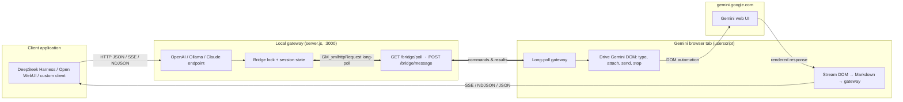
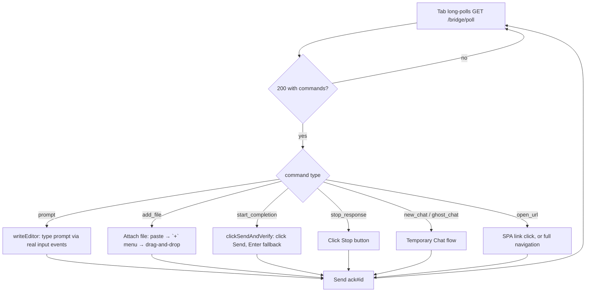

# Gemini Web Bridge

> Drive Gemini's web UI (`gemini.google.com`) from a local OpenAI / Ollama / Claude endpoint. A Tampermonkey userscript steers your browser tab; an Express gateway speaks your client's protocol.

[](README.md#license)
[](https://nodejs.org)
[](https://expressjs.com)

## At a glance

| | |
|---|---|
| **Gateway** | `server.js` — Express on `http://127.0.0.1:3000` |
| **Browser driver** | `public/gemini-bridge.userscript.user.js` — userscript for Gemini Web UI |
| **Tab ↔ gateway** | Long-polling over `GM_xmlhttpRequest` (Gemini's CSP blocks WebSocket to `127.0.0.1`) |
| **Model ID** | `gemini-web` |

## Translations

- [English (this file)](README.md)
- [中文（繁體）](docs/README.traditional.md)
- [中文（简体）](docs/README.simplified.md)

---

## Contents

- [Overview](#overview)
- [Architecture](#architecture)
- [Quick start](#quick-start)
- [API reference](#api-reference)
- [Request examples](#request-examples)
- [Thinking / reasoning modes](#thinking-reasoning-modes)
- [Ghost Mode (Temporary Chat) & sessions](#ghost-mode-temporary-chat--sessions)
- [Tool calling / local-function protocol](#tool-calling--local-function-protocol)
- [File & image attachments](#file--image-attachments)
- [Environment variables](#environment-variables)
- [User restrictions & limitations](#user-restrictions--limitations)
- [Logic reference](#logic-reference)
- [Flowcharts](#flowcharts)
- [Troubleshooting](#troubleshooting)
- [Security notes](#security-notes)
- [License](#license)

---

## Overview

`gemini-bridge` turns Gemini's web UI into a model endpoint you can call like any other local LLM. Your client sends an ordinary chat request to `http://127.0.0.1:3000/v1/chat/completions` (or an Ollama / Claude-flavored path), and the bridge:

1. Picks (or reuses) the active Gemini browser tab driven by the userscript.
2. Optionally opens a fresh **Ghost Mode** (Temporary Chat) window so context is injected cleanly.
3. Types your prompt into Gemini's composer, attaches any files or images, clicks **Send**.
4. Streams Gemini's response back to your client as it appears in the DOM, converted to Markdown.
5. Supports multi-round thinking (`off` / `low` / `medium` / `high`), tool calls via `【TOOL_CALL name="..."】`, automatic retries on transient Gemini web errors, and session continuation across turns.

> **One bridge tab at a time.** The gateway holds a single active tab. If a second Gemini tab claims the bridge, the first one stops. Only one tab should run the bridge at once.

---

## Architecture



The userscript injects a floating button into Gemini's page. Click it to register the tab as the bridge; the tab then long-polls `GET /bridge/poll` for commands (`prompt`, `add_file`, `start_completion`, `stop_response`, `new_chat`, `open_url`) and reports results through `POST /bridge/message`.

---

## Quick start

### 1. Install dependencies

```bash
cd gemini-bridge
npm install
```

Only dependency: `express` (plus Node.js built-ins: `events`, `crypto`, `fetch`).

### 2. Install the userscript

Install Tampermonkey or Violentmonkey in the browser you use for Gemini, then add this userscript:

`public/gemini-bridge.userscript.user.js`

Key metadata:

```js
// @name         Gemini Web Bridge for Local Gateway
// @match        https://gemini.google.com/*
// @match        https://gemini.google.com/u/*/app*
// @grant        GM_xmlhttpRequest
// @connect      127.0.0.1
// @connect      localhost
```

### 3. Start the gateway

```bash
node server.js
```

Expected output:

```
[HTTP] OpenAI-compatible API listening on http://127.0.0.1:3000/v1
[TAB]  Waiting for the userscript to poll http://127.0.0.1:3000/bridge/...
```

### 4. Activate the bridge tab

1. Open `https://gemini.google.com` in the browser with the userscript installed.
2. Make sure you are in **Temporary Chat** (Ghost Mode).
3. Click the floating bridge button (bottom-right) until it shows **Bridge active** (green dot).
4. The tab is registered; `GET /health` reports `connected: true`.

### 5. Smoke test

```bash
curl http://127.0.0.1:3000/health
# {"connected":true,"busy":false}

curl -X POST http://127.0.0.1:3000/v1/chat/completions \
  -H "Content-Type: application/json" \
  -d '{"model":"gemini-web","messages":[{"role":"user","content":"Say hello in one sentence."}],"stream":false}'
```

You should receive a JSON chat completion whose content is Gemini's answer, streamed through your browser tab.

---

## API reference

### Base URL

```
http://127.0.0.1:3000
```

The gateway listens on port `3000` (`HTTP_PORT`). It is local-only by default (loopback address); CORS is open (`Access-Control-Allow-Origin: *`) so browser-based UIs can call it.

### Endpoints

| Method | Path | Purpose |
|---|---|---|
| `GET` | `/health` | Health check: `{ connected, busy }` |
| `GET` | `/models` | OpenAI-style model list: `[{ id: "gemini-web", ... }]` |
| `GET` | `/api/tags` | Ollama model list |
| `GET` | `/api/version` | Ollama version: `{ "version": "0.5.0" }` |
| `GET` | `/bridge/poll` | Userscript long-poll (tab registers here; holds until a command is ready or 204) |
| `POST` | `/bridge/message` | Userscript sends `report_existence`, `ack`, `error`, `message_stream`, `message_completed` |
| `POST` | `/*(chat/completions\|api/chat\|api/generate\|messages\|openai\|open-ai\|ollama\|claude)` | Universal chat completion handler (OpenAI / Ollama / Claude) |

### Protocol detection

The path and headers select the response wire format:

| Condition | Protocol |
|---|---|
| path ends with `/messages`, contains `/claude` or `/anthropic/`, or `anthropic-version` header present | **Claude** (SSE, Anthropic events) |
| path ends with `/api/chat`, `/api/generate`, or contains `/ollama` | **Ollama** (NDJSON) |
| otherwise | **OpenAI** (SSE `data:` chunks + `data: [DONE]`) |

So you can call `POST /v1/chat/completions` (OpenAI), `POST /api/chat` or `/api/generate` (Ollama), or `/messages` / `/claude/...` (Claude).

### Chat request body

```json
{
  "model": "gemini-web",
  "messages": [ { "role": "user", "content": "..." } ],
  "stream": true,
  "thinking_level": "medium",
  "reasoning_effort": "medium",
  "new_chat": false,
  "tools": [ ... ],
  "enable_thinking": false
}
```

| Field | Type | Default | Meaning |
|---|---|---|---|
| `model` | string | `"gemini-web"` | Model label echoed in responses. |
| `messages` | array | required | OpenAI-style messages. `prompt` string accepted as a single-user-message fallback. |
| `prompt` | string | — | Alternative to `messages`: treated as one user turn. |
| `stream` | boolean | `true` | When `false`, a single JSON response is returned after completion. |
| `thinking_level` / `reasoning_effort` | string | `"off"` | `off`, `low`, `medium`, `high`. Controls reasoning rounds before the final answer. |
| `new_chat` | boolean | `false` | Force a fresh Ghost Chat (Temporary Chat) instead of continuing the current session. |
| `tools` | array | — | Declares available local functions; the model may emit `【TOOL_CALL name="..."】` blocks. |
| `enable_thinking` | boolean | — | `false` disables thinking (`off`). |

Extra fields `body.reasoning`, `body.extra_body.reasoning_effort`, `body.extra_body.thinking_level` are also read when resolving the thinking level.

> **Output formatting constraint.** Gemini's web UI corrupts triple-backtick code blocks, so the bridge instructs the model to use `···` fences, and strips `[[REASON]]`, `【TOOL_CALL】`, `【END_RESPONSE】` control tags from client-visible text. Do not rely on ``` blocks in model output through this bridge.

### Response formats

**OpenAI (streaming)** — `text/event-stream`:

```
data: { "id": "chatcmpl-...", "object": "chat.completion.chunk", ..., "choices": [{ "delta": { "role": "assistant", "content": "" } }] }

data: { ... "delta": { "content": "Hello" } }

data: [DONE]
```

Reasoning content streams in `delta.reasoning_content`; tool calls in `delta.tool_calls`. A final usage chunk reports `prompt_tokens`, `completion_tokens` (reasoning + output), and `total_tokens`.

**Ollama (streaming)** — `application/x-ndjson`:

```json
{ "model": "gemini-web", "created_at": "...", "message": { "role": "assistant", "content": "Hello" }, "done": false }
{ "model": "...", ..., "done": true, "done_reason": "stop", ... }
```

For `/api/generate`, chunks use the top-level `response` field instead of `message`.

**Claude (streaming)** — `text/event-stream` with events: `message_start`, `content_block_start`, `content_block_delta`, `content_block_stop`, `message_delta`, `message_stop`.

**Non-streaming** — a single JSON object in the OpenAI / Ollama / Claude shape matching the detected protocol.

### Errors

| Status | Meaning |
|---|---|
| `400` | `messages` / `prompt` missing. |
| `502` (non-streaming) or SSE error event (streaming) | `bridge_error` when the tab is disconnected, times out, or Gemini returns a non-retryable error. |

Transient Gemini errors (rate limit, `1095`, network drop, empty output) are retried automatically (see [Retry logic](#retry-logic)).

---

## Request examples

### cURL (OpenAI, non-streaming)

```bash
curl -X POST http://127.0.0.1:3000/v1/chat/completions \
  -H "Content-Type: application/json" \
  -d '{
    "model": "gemini-web",
    "messages": [{"role":"user","content":"Explain quantum computing in one paragraph."}],
    "stream": false,
    "thinking_level": "medium"
  }'
```

### cURL (Ollama)

```bash
curl -X POST http://127.0.0.1:3000/api/chat \
  -H "Content-Type: application/json" \
  -d '{
    "model": "gemini-web",
    "messages": [{"role":"user","content":"Hello"}],
    "stream": false
  }'
```

### Python (OpenAI SDK, pointing at the local bridge)

```python
from openai import OpenAI

client = OpenAI(
    base_url="http://127.0.0.1:3000/v1",
    api_key="not-needed",
)

resp = client.chat.completions.create(
    model="gemini-web",
    messages=[{"role": "user", "content": "Hi, are you there?"}],
    stream=False,
)
print(resp.choices[0].message.content)
```

### JavaScript (fetch, streaming)

```javascript
const res = await fetch("http://127.0.0.1:3000/v1/chat/completions", {
  method: "POST",
  headers: { "Content-Type": "application/json" },
  body: JSON.stringify({
    model: "gemini-web",
    messages: [{ role: "user", content: "Stream me a poem." }],
    stream: true,
  }),
});

const reader = res.body.getReader();
while (true) {
  const { done, value } = await reader.read();
  if (done) break;
  // parse "data: ..." SSE chunks here
}
```

---

## Thinking / reasoning modes

`thinking_level` (a.k.a. `reasoning_effort`) controls how the bridge prepares the answer before executing tools or returning text:

| Mode | Behavior | Reasoning rounds |
|---|---|---|
| `off` | Direct single turn: prompt → answer (or tool calls) | 0 |
| `low` | One deep-thinking round (`[[REASON]]...[[/REASON]]`), then final execution | 1 |
| `medium` | Same as `low` | 1 |
| `high` | Deep-thinking round, then a **critical rethink** round, then final execution | 2 |

Resolution order for the level:

1. `enable_thinking === false`, `thinking.type === "disabled"`, `reasoning.enabled === false`, or `reasoning.exclude === true` → `off`
2. `thinking_level` ?? `reasoning_effort` ?? `reasoning.effort` ?? `extra_body.reasoning_effort` ?? `extra_body.thinking_level`
3. Absent / empty → `off`
4. `off|none|disabled|false|0` → `off`; `low|minimal` → `low`; `high|xhigh|max` → `high`; anything else → `medium`

### Round flow

1. **Round 1 — Deep thought:** Gemini is asked to reason inside `[[REASON]]...[[/REASON]]` (plain text only, no Markdown, no tool calls).
2. **Round 2 — Critical rethink** (`high` mode only): a second pass checks for better solutions, missing details, or errors.
3. **Final — Execution:** The model outputs either `【TOOL_CALL name="..."】{...}【/TOOL_CALL】` blocks to invoke local functions, or a plain answer ending with `【END_RESPONSE】`.
4. **Audit loop (max 2 attempts):** If tools were expected but neither `【TOOL_CALL】` nor `【END_RESPONSE】` appeared, the bridge sends an audit prompt and retries.

Reasoning text streams to the client as `reasoning_content` (OpenAI) or `thinking` (Ollama) while it is produced.

---

## Ghost Mode (Temporary Chat) & sessions

The bridge runs Gemini in **Temporary Chat** (Ghost Mode) so each conversation starts from a clean window and is not used to train models.

### Session rules

- The session is bound strictly to the live browser tab's `tabId`. If the tab disconnects, the session dies (`ghostSession = null`).
- A fresh Ghost Chat is opened when `new_chat: true` is requested, when the session watermark is reached (`cumulativeChars >= 100000`, approx. the 32k-context safety margin), or when there is no valid session yet.
- **Continuation (delta mode):** if the same tab, same session id, and a strict prefix match of previous non-assistant turns hold, only the *new* turns are sent to Gemini — avoiding re-transmitting the whole history.
- Strict survival check: same tab id + same `clientSessionId` (`x-session-id` / `x-conversation-id` header or `metadata.session_id`) + `prevNonAssistant` is a strict prefix of `normalizedNonAssistant` + more turns than before.
- Turn fingerprints normalize away dynamic timestamps and harness-injected runtime tags (`<time-context>`, `<runtime-context>`, `<system-reminder>`, `<skill-catalog>`, etc.) so mid-loop steps stay in the same session.

### Timeouts & pacing

| Constant | Default | Meaning |
|---|---|---|
| `TAB_TIMEOUT_MS` | 45 s | Tab is dead if it hasn't polled in 45 s. |
| `TURN_COOLDOWN_MS` | 2.5 s | Anti-rate-limit pause between consecutive web turns. |
| `BRIDGE_SEND_DELAY_MS` | 5 s (env-overridable) | Delay before sending the prompt to Gemini's web UI. |
| `STREAM_STALL_TIMEOUT_MS` | 180 s | Turn aborted if the stream stalls for 3 minutes. |
| `TAB_OFFLINE_TIMEOUT_MS` | 15 s | Watchdog fails the turn if the tab goes offline for 15 s. |
| `MAX_SESSION_CHARS` | 100 000 | Session watermark after which the next turn opens a fresh Ghost Chat. |

---

## Tool calling / local-function protocol

When `tools` are declared, Gemini may emit local-tool invocations instead of (or before) a plain answer. The bridge never uses Gemini's built-in Python sandbox or web tools; all execution goes through your local tool layer.

### Wire format

```
【TOOL_CALL name="function_name"】{"arg1": "value1"}【/TOOL_CALL】
```

For multi-line content (file paths, code):

```
【TOOL_CALL name="write"】{"file_path": "example.html", "content": "⟦CONTENT_START⟧
<!DOCTYPE html>...
⟦CONTENT_END⟧"}【/TOOL_CALL】
```

Rules:

- Use exact bare function names — never prefix with `default_api:`.
- Code blocks use `···` (three middle dots) as fences — **never** triple backticks ``` — Gemini's web UI corrupts backtick blocks.
- A pure-text answer ends with `【END_RESPONSE】`; do not output it if you still need to call tools.
- The bridge parses `【TOOL_CALL】`/`【/TOOL_CALL】` blocks (also tolerant of `[` `]` bracket variants and omitted closing tags after long blocks), emits them as structured `tool_calls` in the response, and runs an audit loop (up to 2 attempts) if the model forgets them.

### OpenAI tool-calls in responses

Streaming OpenAI responses emit `delta.tool_calls` chunks; non-streaming responses include `message.tool_calls` with `finish_reason: "tool_calls"`.

---

## File & image attachments

Attachments travel from the request body through the gateway to the userscript, which pastes them into Gemini's composer (clipboard paste → `+` menu → drag-and-drop fallbacks) and waits for upload to finish.

Supported part types:

- `text` — ordinary text
- `image_url` (OpenAI style) — `data:image/...;base64,...` or an `https://` URL (fetched server-side)
- `image` / `source.base64` (Claude style)
- `file` — `{ filename, file_data }` text attachments
- `images` — array of base64 strings

Images are estimated at ~258 tokens each; text files are counted with the CJK-aware estimator. When `GEMINI_API_KEY` is set, exact token counts come from Google's `countTokens` REST API; otherwise the local estimator is used.

---

## Environment variables

| Variable | Default | Meaning |
|---|---|---|
| `GEMINI_API_KEY` | `""` | Enables exact token counting via Google's `countTokens` REST API (`gemini-2.5-flash`). |
| `BRIDGE_SEND_DELAY_MS` | `5000` | Milliseconds to wait before sending a prompt to Gemini's web UI (helps avoid rate limits). |

```bash
GEMINI_API_KEY=your_key BRIDGE_SEND_DELAY_MS=3000 node server.js
```

---

## User restrictions & limitations

Review these constraints before integrating the bridge.

1. **Gemini account & web UI required.** A working Gemini account and access to `gemini.google.com` are required. The bridge drives the official web UI; no Gemini API key is needed for generation (only optional, for token counting).
2. **One active bridge tab at a time.** Only one tab should run the bridge; a second tab claiming the bridge stops the first.
3. **Temporary Chat (Ghost Mode) only.** Every session is opened in Temporary Chat. Persistent Gemini conversation history on Google's side is not preserved — sessions are ephemeral by design.
4. **No WebSocket; long-polling only.** Gemini's CSP blocks `ws://127.0.0.1`, so the tab ↔ gateway transport is HTTP long-polling (`GET /bridge/poll`), typically every 100 ms–1 s with exponential backoff on errors.
5. **Gemini rate limits apply.** All generation consumes your Gemini web quota. Rate-limit errors (e.g. `(1095)`, `Rate limit`) trigger automatic retries with backoff, but repeated heavy use may still be throttled by Google.
6. **Userscript manager required.** Install Tampermonkey/Violentmonkey (or similar) and grant `GM_xmlhttpRequest` for `127.0.0.1` and `localhost`. The userscript only runs on `gemini.google.com` top-level frames (helper iframes are ignored).
7. **Concurrency: one request at a time.** A bridge lock serializes chat requests; additional requests are queued and served in order. `GET /health` reports `busy: true` during execution.
8. **Timeouts.** Tab offline: 15 s → turn fails. Stream stall: 180 s → turn fails. `start_completion` wait: 35 s; `performAction` default: 20 s; `add_file`: 60 s.
9. **Session size watermark.** When cumulative session chars reach 100 000, the next turn opens a fresh Ghost Chat (context handoff summary is injected). Very long conversations restart context.
10. **Local execution risk.** The bridge exposes a tool protocol with full local filesystem/tool access through your tool layer. Only connect trusted clients; CORS is open (`*`) by default.
11. **Not an official Google product.** This is an unofficial bridge that automates the Gemini web UI. Behavior can change if Google changes the page DOM or class names.

---

## Logic reference

### Request lifecycle (chat completion)

```
Client POST /v1/chat/completions
  ├─ detect protocol (OpenAI / Ollama / Claude)
  ├─ acquire bridge lock (queue if another turn is running)
  ├─ formatIncomingMessages():
  │    ├─ build workspace_spec.txt (system + tools + output rules)
  │    ├─ title-generation shortcut → local answer, no Gemini tab
  │    └─ session decision: continuation vs fresh Ghost Chat
  ├─ if fresh Ghost Chat: userscript new_chat (Temporary Chat)
  ├─ attach files (add_file, one by one, 60 s each)
  ├─ send prompt to Gemini tab (prompt action)
  ├─ start_completion → stream deltas → message_completed / error
  ├─ (thinking modes) run reasoning round(s) before the final turn
  ├─ (tool mode) parse 【TOOL_CALL】 blocks; audit loop up to 2 attempts
  ├─ release bridge lock
  └─ stream/JSON response back to client
```

### Session continuation logic

```
New request
  │
  ├─ forceNewChat or needsRefresh? ─────────────── Yes → Fresh Ghost Chat (full context)
  │
  No
  │
  ├─ same tab id? ───────────────────────────── No → Fresh Ghost Chat
  │
  ├─ same client session id? ────────────────── No → Fresh Ghost Chat
  │
  ├─ previous turns are a strict prefix of current turns?  No → Fresh Ghost Chat
  │
  ├─ more turns than already sent? ───────────── No → Fresh Ghost Chat
  │
  └─ Yes → Delta continuation: send only new turns (efficient)
```

### Thinking round logic

```
thinking_level == "off"?
  Yes → Direct single turn → 【TOOL_CALL】 or 【END_RESPONSE】 → done
  No  → Round 1: [[REASON]] deep thought
        ├─ model emitted premature 【TOOL_CALL】? → capture it, skip remaining rounds
        ├─ high mode? → Round 2: critical rethink
        │     ├─ premature 【TOOL_CALL】? → capture it, skip final turn
        │     └─ proceed to final execution turn
        └─ Final execution turn → tool calls or plain answer + 【END_RESPONSE】
              ├─ audit loop (max 2) if missing tool calls / END_RESPONSE
              └─ stream text + tool_calls to client
```

### Retry logic

```
Gemini turn error
  │
  ├─ transient error? (rate limit, 1095, "Something went wrong", network, empty output, stall, timeout)
  │   Yes → attempt < maxRetries (3)?
  │       Yes → backoff (min(attempt*2500 ms, 8000 ms); rate limit → 10–30 s)
  │           ├─ attempt >= 2 AND files attached → new_chat + re-attach all files
  │           └─ resend prompt
  │       No → reject → 502 bridge_error / SSE error
  │
  No → reject immediately → 502 bridge_error / SSE error
```

### Userscript command loop

```
Tab long-polls GET /bridge/poll → {200 with commands?}
  No → back to polling
  Yes → {command type}
        prompt       → writeEditor: type prompt via real input events
        add_file     → attach file: paste → `+` menu → drag-and-drop
        start_completion → clickSendAndVerify: click Send, Enter fallback
        stop_response → click Stop button
        new_chat / ghost_chat → Temporary Chat flow
        open_url     → SPA link click, or full navigation
        → send ack#id → back to polling
```

### Token estimation (local fallback)

```
CJK chars * 1.15
+ Latin words: max(1, ceil(length / 4)) per word
+ code punctuation * 0.65
+ images * 258
```

When `GEMINI_API_KEY` is set, exact counting comes from `https://generativelanguage.googleapis.com/v1beta/models/gemini-2.5-flash:countTokens?key=...`, falling back to the estimator on any failure.

---

## Flowcharts

All diagrams use Mermaid syntax and render on GitHub, GitLab, and most Markdown viewers.

### 1. System architecture


### 2. Chat completion lifecycle

```mermaid
flowchart TD
    A[Client: POST /v1/chat/completions] --> B[Detect protocol: OpenAI / Ollama / Claude]
    B --> C[Acquire bridge lock · queue if busy]
    C --> D[formatIncomingMessages]
    D --> E{Session decision}
    E -- force / watermark / no prefix match --> F[Open fresh Ghost Chat: Temporary Chat]
    E -- same tab + session + prefix match --> G[Delta continuation: send only new turns]
    F --> H[Attach files: add_file × N]
    G --> H
    H --> I[Send prompt to Gemini tab]
    I --> J[start_completion → stream deltas]
    J --> K{message_completed?}
    K -- error / timeout --> L[Retry up to 3 × (backoff; new_chat + re-attach on attempt ≥2 with files)]
    L --> I
    K -- yes --> M[Parse 【TOOL_CALL】 / 【END_RESPONSE】]
    M --> N[Audit loop max 2 if missing tool calls / END_RESPONSE]
    N --> O[Release bridge lock]
    O --> P[Stream / JSON response to client]
```

### 3. Thinking / reasoning rounds

```mermaid
flowchart TD
    A[thinking_level resolved] --> B{off?}
    B -- yes --> C[Direct single turn: prompt → answer / tools]
    B -- no --> D[Round 1: [[REASON]] deep thought]
    D --> E{premature 【TOOL_CALL】?}
    E -- yes --> F[Capture tool calls; skip remaining rounds → C]
    E -- no --> G{high mode?}
    G -- no --> H[Final execution turn]
    G -- yes --> I[Round 2: critical rethink]
    I --> J{premature 【TOOL_CALL】?}
    J -- yes --> F
    J -- no --> H
    H --> K{has tools && missing TOOL_CALL/END_RESPONSE?}
    K -- yes --> L[Audit prompt · retry up to 2]
    L --> H
    K -- no --> M[Stream reasoning + content + tool_calls to client]
    C --> M
```

### 4. Session continuation vs fresh Ghost Chat

```mermaid
flowchart TD
    A[New chat request arrives] --> B{forceNewChat or needsRefresh (>=100k chars)?}
    B -- yes --> C[Fresh Ghost Chat · full context injected]
    B -- no --> D{same tab id?}
    D -- no --> C
    D -- yes --> E{same client session id?}
    E -- no --> C
    E -- yes --> F{previous turns = strict prefix of current turns?}
    F -- no --> C
    F -- yes --> G{more turns than already sent?}
    G -- no --> C
    G -- yes --> H[Delta continuation: only new turns sent to Gemini]
```

### 5. Retry logic

```mermaid
flowchart TD
    A[Gemini turn error] --> B{transient error?}
    B -- no --> C[Reject: 502 bridge_error / SSE error]
    B -- yes --> D{attempt < maxRetries 3?}
    D -- no --> C
    D -- yes --> E[Backoff: min(attempt*2500 ms, 8000 ms); rate limit → 10–30 s]
    E --> F{attempt >= 2 with files attached?}
    F -- yes --> G[new_chat + re-attach all files]
    F -- no --> H[Resend prompt to Gemini]
    G --> H
    H --> A
```

### 6. Userscript command loop



---

## Troubleshooting

| Symptom | Likely cause | Fix |
|---|---|---|
| `GET /health` → `connected: false` | Userscript not running, or tab not registered | Open Gemini, click bridge button until it shows "Bridge active" |
| Poll errors: `Cannot reach http://127.0.0.1:3000` | Gateway not started | Run `node server.js` |
| `502 bridge_error: No active Gemini Web Bridge connected` | Tab closed, navigated away, or timed out (45 s) | Re-activate the bridge tab; re-open Gemini |
| Turn fails after 180 s | Stream stalled | Check the Gemini tab manually; simplify the prompt; retry |
| Rate limit `(1095)` / "Slowing Down" | Gemini web quota | Wait; lower concurrency; increase `BRIDGE_SEND_DELAY_MS` |
| Code blocks come out mangled | Gemini web UI corrupts triple backticks | Use `···` fences in model output; this is by design |
| `another tab claimed the bridge` | Two tabs running the bridge | Stop the bridge on all but one tab |
| File attachment fails | Composer not ready, or upload spinner stuck | Wait for the send button; images add ~800 ms settle time |
| Context resets often | Session hit the 100k-char watermark | Expected; pass `new_chat: true` to force a clean start manually |

---

## Security notes

- The gateway binds to `127.0.0.1:3000` by default. Do not expose it to the internet without authentication.
- CORS is `Access-Control-Allow-Origin: *` to allow browser-based clients; tighten this header in `server.js` if you run in a shared environment.
- The `【TOOL_CALL】` protocol gives the model a path to invoke local functions through your tool layer. Only connect trusted clients.
- `GM_xmlhttpRequest` grants the userscript privileged HTTP access to `127.0.0.1`/`localhost`; install the userscript only from this repository or a source you audit.

---

## License

AGPL-3.0