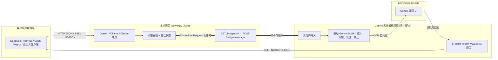
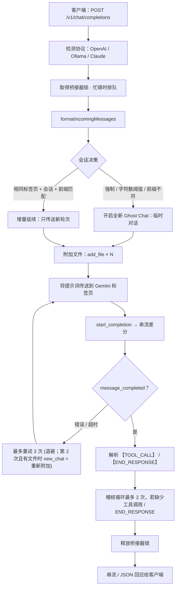
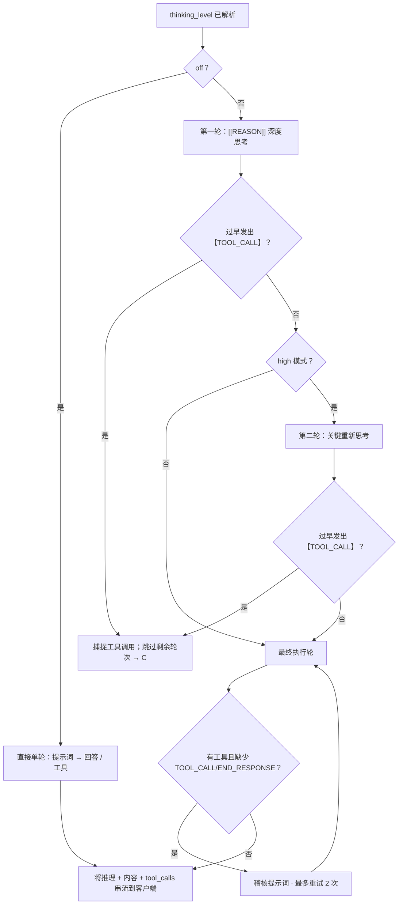
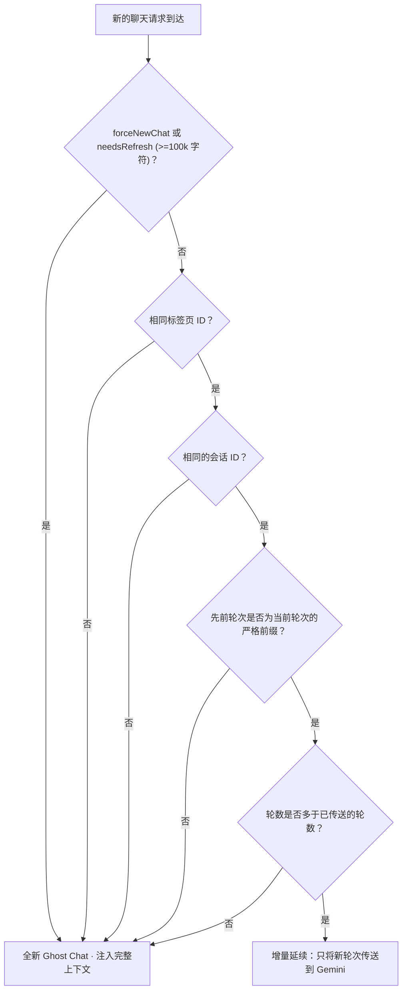
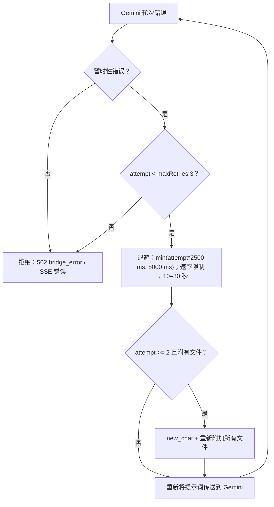
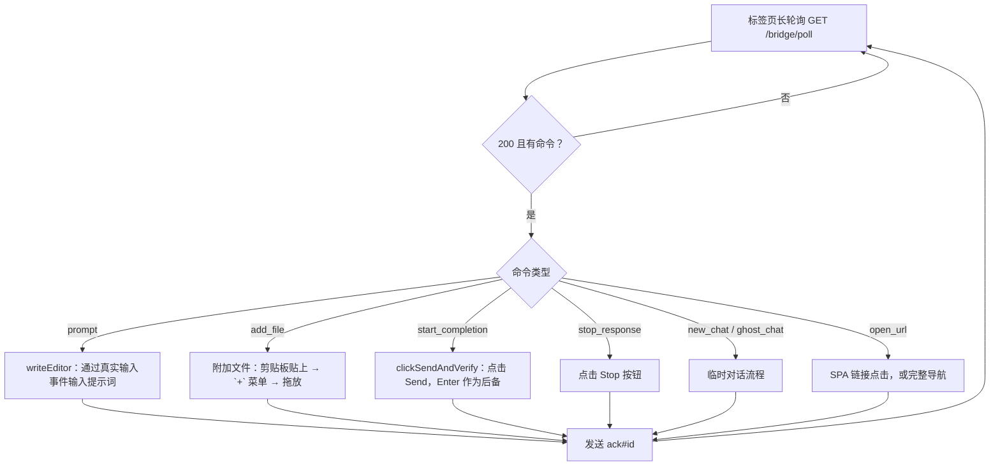

# Gemini Web Bridge

> 把 Gemini 网页版 (`gemini.google.com`) 当成本地 OpenAI / Ollama / Claude 端点来驱动。一个 Tampermonkey 用户脚本操作你的浏览器标签页；Express 网关则说你客户端的协议。

[](README.md#授权)
[](https://nodejs.org)
[](https://expressjs.com)

## 一览表

| | |
|---|---|
| **网关** | `server.js` — Express，监听 `http://127.0.0.1:3000` |
| **浏览器驱动程序** | `public/gemini-bridge.userscript.user.js` — Gemini 网页版用户脚本 |
| **标签页 ↔ 网关** | 长轮询经 `GM_xmlhttpRequest`（Gemini 的 CSP 封锁 WebSocket 到 `127.0.0.1`） |
| **模型 ID** | `gemini-web` |

## 语言版本

- [English（本文档）](../README.md)
- [中文（繁體）](../README.traditional.md)
- [中文（简体）](README.simplified.md)

---

## 目录

- [概述](#概述)
- [架构](#架构)
- [快速入门](#快速入门)
- [API 参考](#api-参考)
- [请求示例](#请求示例)
- [思考 / 推理模式](#思考-推理模式)
- [Ghost Mode（临时对话）与会话](#ghost-mode-临时对话与会话)
- [工具调用 / 本地函数协议](#工具调用-本地函数协议)
- [文件与图片附件](#文件与图片附件)
- [环境变量](#环境变量)
- [用户限制与注意事项](#用户限制与注意事项)
- [逻辑参考](#逻辑参考)
- [流程图](#流程图)
- [疑难排解](#疑难排解)
- [安全说明](#安全说明)
- [授权](#授权)

---

## 概述

`gemini-bridge` 将 Gemini 网页版变成你可以像呼叫其他本地 LLM 端点一样呼叫的模型端点。你的客户端发送一般的聊天请求到 `http://127.0.0.1:3000/v1/chat/completions`（或 Ollama / Claude 风格的路径），桥接器会：

1. 选择（或复用）由用户脚本驱动的作用中 Gemini 浏览器标签页。
2. 视需要开启全新的 **Ghost Mode（临时对话）** 窗口，干净地注入上下文。
3. 将你的提示词输入 Gemini 的编辑器，附加任何文件或图片，点击 **Send**。
4. 当 Gemini 在 DOM 中回应时，将串流回应转成 Markdown 传回你的客户端。
5. 支持多轮“思考”（`off` / `low` / `medium` / `high`）、通过 `【TOOL_CALL name="..."】` 进行工具调用、在 Gemini 网页暂时性错误时自动重试，以及跨轮次的会话延续。

> **同一时间只有一个桥接器标签页。** 网关保留单一作用中标签页。若第二个 Gemini 标签页声称桥接器，第一个会停止。同一时间只应让一个标签页运行桥接器。

---

## 架构



用户脚本会将一个悬浮按钮注入 Gemini 页面。点击它将标签页注册为桥接器；标签页随后对 `GET /bridge/poll` 进行长轮询，等待命令（`prompt`、`add_file`、`start_completion`、`stop_response`、`new_chat`、`open_url`），并通过 `POST /bridge/message` 回报结果。

---

## 快速入门

### 1. 安装依赖包

```bash
cd gemini-bridge
npm install
```

唯一依赖：`express`（以及 Node.js 内建模块：`events`、`crypto`、`fetch`）。

### 2. 安装用户脚本

在你用来开启 Gemini 的浏览器中安装 Tampermonkey 或 Violentmonkey，然后加入此用户脚本：

`public/gemini-bridge.userscript.user.js`

关键元数据：

```js
// @name         Gemini Web Bridge for Local Gateway
// @match        https://gemini.google.com/*
// @match        https://gemini.google.com/u/*/app*
// @grant        GM_xmlhttpRequest
// @connect      127.0.0.1
// @connect      localhost
```

### 3. 启动网关

```bash
node server.js
```

预期输出：

```
[HTTP] OpenAI-compatible API listening on http://127.0.0.1:3000/v1
[TAB]  Waiting for the userscript to poll http://127.0.0.1:3000/bridge/...
```

### 4. 启用桥接器标签页

1. 在已安装用户脚本的浏览器中开启 `https://gemini.google.com`。
2. 确认处于 **临时对话（Temporary Chat / Ghost Mode）**。
3. 点击右下角的悬浮桥接器按钮，直到显示 **Bridge active（绿点）**。
4. 标签页现已注册；`GET /health` 回报 `connected: true`。

### 5. 需冒烟测试

```bash
curl http://127.0.0.1:3000/health
# {"connected":true,"busy":false}

curl -X POST http://127.0.0.1:3000/v1/chat/completions \
  -H "Content-Type: application/json" \
  -d '{"model":"gemini-web","messages":[{"role":"user","content":"用一句话就说你好。"}],"stream":false}'
```

你应该会收到一个 JSON 聊天完成结果，内容是通过你的浏览器标签页串流而来的 Gemini 回答。

---

## API 参考

### 基础网址

```
http://127.0.0.1:3000
```

网关监听连接端口 `3000`（`HTTP_PORT`）。预设仅监听本地回环地址；CORS 开放（`Access-Control-Allow-Origin: *`），让浏览器型介面能呼叫。

### 端点

| 方法 | 路径 | 用途 |
|---|---|---|
| `GET` | `/health` | 健康检查：`{ connected, busy }` |
| `GET` | `/models` | OpenAI 风格模型列表：`[{ id: "gemini-web", ... }]` |
| `GET` | `/api/tags` | Ollama 模型列表 |
| `GET` | `/api/version` | Ollama 版本：`{ "version": "0.5.0" }` |
| `GET` | `/bridge/poll` | 用户脚本长轮询（标签页在此注册；持续等待直到有命令可用或回传 204） |
| `POST` | `/bridge/message` | 用户脚本发送 `report_existence`、`ack`、`error`、`message_stream`、`message_completed` |
| `POST` | `/*(chat/completions\|api/chat\|api/generate\|messages\|openai\|open-ai\|ollama\|claude)` | 通用聊天完成处理器（OpenAI / Ollama / Claude） |

### 协议检测

路径与标头决定回应的传输格式：

| 条件 | 协议 |
|---|---|
| 路径以 `/messages` 结尾、包含 `/claude` 或 `/anthropic/`、或有 `anthropic-version` 标头 | **Claude**（SSE，Anthropic 事件） |
| 路径以 `/api/chat`、`/api/generate` 结尾，或包含 `/ollama` | **Ollama**（NDJSON） |
| 否则 | **OpenAI**（SSE `data:` 区块 + `data: [DONE]`） |

因此你可以呼叫 `POST /v1/chat/completions`（OpenAI）、`POST /api/chat` 或 `/api/generate`（Ollama）、或 `/messages`、`/claude/...`（Claude）。

### 聊天请求体

```json
{
  "model": "gemini-web",
  "messages": [ { "role": "user", "content": "..." } ],
  "stream": true,
  "thinking_level": "medium",
  "reasoning_effort": "medium",
  "new_chat": false,
  "tools": [ ... ],
  "enable_thinking": false
}
```

| 字段 | 类型 | 预设 | 意义 |
|---|---|---|---|
| `model` | 字符串 | `"gemini-web"` | 模型标签，会回应中回报。 |
| `messages` | 数组 | 必填 | OpenAI 风格消息。`prompt` 字符串可作为单一用户消息的后备。 |
| `prompt` | 字符串 | — | `messages` 的替代方案：视为一个用户轮次。 |
| `stream` | 布尔 | `true` | 为 `false` 时，完成后传回单一 JSON 回应。 |
| `thinking_level` / `reasoning_effort` | 字符串 | `"off"` | `off`、`low`、`medium`、`high`。控制桥接器在最终回答前执行的推理轮数。 |
| `new_chat` | 布尔 | `false` | 强制开启全新的 Ghost Chat（临时对话），而非延续当前会话。 |
| `tools` | 数组 | — | 声明可用的本地函数；模型可能会发出 `【TOOL_CALL name="..."】` 区块。 |
| `enable_thinking` | 布尔 | — | `false` 会将思考设为 `off`。 |

`body.reasoning`、`body.extra_body.reasoning_effort`、`body.extra_body.thinking_level` 等字段在解析思考层级时也会被读取。

> **输出格式限制。** Gemini 网页会损坏三个反引号代码区块，因此桥接器指示模型使用 `···` 围栏，并会从客户端可见文字中剥离 `[[REASON]]`、`【TOOL_CALL】`、`【END_RESPONSE】` 控制标签。不要透过此桥接器依赖 ``` 区块。

### 回应格式

**OpenAI（串流）** — `text/event-stream`:

```
data: { "id": "chatcmpl-...", "object": "chat.completion.chunk", ..., "choices": [{ "delta": { "role": "assistant", "content": "" } }] }

data: { ... "delta": { "content": "Hello" } }

data: [DONE]
```

推理内容会串流在 `delta.reasoning_content` 中；工具调用在 `delta.tool_calls` 中。最终使用量区块会回报 `prompt_tokens`、`completion_tokens`（推理 + 输出）与 `total_tokens`。

**Ollama（串流）** — `application/x-ndjson`:

```json
{ "model": "gemini-web", "created_at": "...", "message": { "role": "assistant", "content": "Hello" }, "done": false }
{ "model": "...", ..., "done": true, "done_reason": "stop", ... }
```

对 `/api/generate`，区块会使用顶层的 `response` 字段而非 `message`。

**Claude（串流）** — `text/event-stream`，事件包含：`message_start`、`content_block_start`、`content_block_delta`、`content_block_stop`、`message_delta`、`message_stop`。

**非串流** — 单一 JSON 对象，形状与检测到的协议相符（OpenAI / Ollama / Claude）。

### 错误

| 状态 | 意义 |
|---|---|
| `400` | 缺少 `messages` / `prompt`。 |
| `502`（非串流）或 SSE 错误事件（串流） | `bridge_error` 当标签页未连线、超时，或 Gemini 回传不可重试错误时。 |

Gemini 的暂时性错误（速率限制、`1095`、网络中断、空白输出）会自动重试（见 [重试逻辑](#重试逻辑)）。

---

## 请求示例

### cURL（OpenAI，非串流）

```bash
curl -X POST http://127.0.0.1:3000/v1/chat/completions \
  -H "Content-Type: application/json" \
  -d '{
    "model": "gemini-web",
    "messages": [{"role":"user","content":"用一段话解释量子运算。"}],
    "stream": false,
    "thinking_level": "medium"
  }'
```

### cURL（Ollama）

```bash
curl -X POST http://127.0.0.1:3000/api/chat \
  -H "Content-Type: application/json" \
  -d '{
    "model": "gemini-web",
    "messages": [{"role":"user","content":"你好"}],
    "stream": false
  }'
```

### Python（使用 OpenAI SDK，指向本地桥接器）

```python
from openai import OpenAI

client = OpenAI(
    base_url="http://127.0.0.1:3000/v1",
    api_key="not-needed",
)

resp = client.chat.completions.create(
    model="gemini-web",
    messages=[{"role": "user", "content": "Hi, are you there?"}],
    stream=False,
)
print(resp.choices[0].message.content)
```

### JavaScript（fetch，串流）

```javascript
const res = await fetch("http://127.0.0.1:3000/v1/chat/completions", {
  method: "POST",
  headers: { "Content-Type": "application/json" },
  body: JSON.stringify({
    model: "gemini-web",
    messages: [{ role: "user", content: "帮我写一首诗并串流输出。" }],
    stream: true,
  }),
});

const reader = res.body.getReader();
while (true) {
  const { done, value } = await reader.read();
  if (done) break;
  // 此处解析 "data: ..." SSE 区块
}
```

---

## 思考 / 推理模式

`thinking_level`（又称 `reasoning_effort`）控制桥接器在执行工具或回传文字前，如何准备答案：

| 模式 | 行为 | 推理轮数 |
|---|---|---|
| `off` | 直接单轮：提示词 → 回答（或工具调用） | 0 |
| `low` | 一轮深度思考 (`[[REASON]]...[[/REASON]]`)，然后最终执行轮 | 1 |
| `medium` | 与 `low` 相同 | 1 |
| `high` | 深度思考轮，然后进行 **关键重新思考** 轮，最后才执行 | 2 |

思考层级的解析顺序：

1. `enable_thinking === false`、`thinking.type === "disabled"`、`reasoning.enabled === false`、或 `reasoning.exclude === true` → `off`
2. `thinking_level` ?? `reasoning_effort` ?? `reasoning.effort` ?? `extra_body.reasoning_effort` ?? `extra_body.thinking_level`
3. 缺失 / 空字符串 → `off`
4. `off|none|disabled|false|0` → `off`；`low|minimal` → `low`；`high|xhigh|max` → `high`；其他 → `medium`

### 轮次流程

1. **第一轮 — 深度思考：** 要求 Gemini 在 `[[REASON]]...[[/REASON]]` 内部推理（纯文字，不含 Markdown、不含工具调用）。
2. **第二轮 — 关键重新思考**（仅 `high` 模式）：第二轮检查是否有更好的解决方案、遗漏细节，或潜在错误。
3. **最终 — 执行轮：** 模型输出 `【TOOL_CALL name="..."】{...}【/TOOL_CALL】` 区块来调用本地函数，或输出纯文字答案并以 `【END_RESPONSE】` 结束。
4. **稽核循环（最多 2 次尝试）：** 若预期会有工具，但既没有 `【TOOL_CALL】` 也没有 `【END_RESPONSE】`，桥接器会发送稽核提示词并重试。

推理文字会在产生时，以 `reasoning_content`（OpenAI）或 `thinking`（Ollama）形式串流到客户端。

---

## Ghost Mode（临时对话）与会话

桥接器让 Gemini 在 **临时对话（Temporary Chat，Ghost Mode）** 中运行，让每个对话从干净窗口开始，且不会被用来训练模型。

### 会话规则

- 会话严格绑定到当前浏览器标签页的 `tabId`。若标签页断线，会话即结束（`ghostSession = null`）。
- 在以下情况会开启全新的 Ghost Chat：
  - 请求 `new_chat: true`，或
  - 会话字符数达到阈值（`cumulativeChars >= 100000`，约为 32k 内容窗口的安全余量），或
  - 尚无有效会话。
- **延续（增量模式）：** 若同一标签页、相同的会话 ID，且先前的非助手消息严格为当前消息的前缀，则只会将“新增的”轮次传送给 Gemini，避免重复传输完整历史。
- 严格的存活检查：相同标签页 ID + 相同的 `clientSessionId`（`x-session-id` / `x-conversation-id` 标头，或 `metadata.session_id`）+ `prevNonAssistant` 严格为 `normalizedNonAssistant` 的前缀 + 轮数多于已传送的轮数。
- 轮次指纹会正规化掉动态时间戳与中继层注入的运行时标签（`<time-context>`、`<runtime-context>`、`<system-reminder>`、`<skill-catalog>` 等），让中间循环步骤停留在同一会话中。

### 超时与节流

| 常量 | 预设值 | 意义 |
|---|---|---|
| `TAB_TIMEOUT_MS` | 45 秒 | 标签页 45 秒未轮询即视为断线。 |
| `TURN_COOLDOWN_MS` | 2.5 秒 | 连续网页轮次间的防速率限制间隔。 |
| `BRIDGE_SEND_DELAY_MS` | 5 秒（可通过环境变量覆盖） | 将提示词传送到 Gemini 网页前的延迟。 |
| `STREAM_STALL_TIMEOUT_MS` | 180 秒 | 串流停滞 3 分钟则中止轮次。 |
| `TAB_OFFLINE_TIMEOUT_MS` | 15 秒 | 看门狗：标签页离线 15 秒则轮次失败。 |
| `MAX_SESSION_CHARS` | 100 000 | 会话字符数阈值，超过后下一轮会开启新的 Ghost Chat。 |

---

## 工具调用 / 本地函数协议

当声明 `tools` 时，Gemini 可能会输出本地工具调用，而非（或在）纯文字回答。桥接器永不使用 Gemini 内建的 Python 沙箱或网页工具；所有执行都通过你的本地工具层完成。

### 传输格式

```
【TOOL_CALL name="function_name"】{"arg1": "value1"}【/TOOL_CALL】
```

多行内容（文件路径、代码）：

```
【TOOL_CALL name="write"】{"file_path": "example.html", "content": "⟦CONTENT_START⟧
<!DOCTYPE html>...
⟦CONTENT_END⟧"}【/TOOL_CALL】
```

规则：

- 使用精确的裸函数名称 — 永不加 `default_api:` 前缀。
- 代码区块使用 `···`（三个中间点）作为围栏，**永不**使用三个反引号 ``` — Gemini 网页会损坏反引号区块。
- 纯文字答案以 `【END_RESPONSE】` 结尾；若仍需调用工具，请不要输出它。
- 桥接器会解析 `【TOOL_CALL】`/`【/TOOL_CALL】` 区块（也可容忍 `[` `]` 括号变体，以及长区块后遗漏的闭合标签），将其发送为回应中结构化的 `tool_calls`，并执行稽核循环（最多 2 次尝试），以防模型遗漏它们。

### OpenAI 工具调用回应

串流 OpenAI 回应会发送 `delta.tool_calls` 区块；非串流回应会在 `message.tool_calls` 中包含，并以 `finish_reason: "tool_calls"` 结束。

---

## 文件与图片附件

附件从请求体经过网关，传送到用户脚本，由脚本粘贴到 Gemini 的编辑器中（剪贴板贴上 → `+` 菜单 → 拖放后备），并等待上传完成。

支持的部分类型：

- `text` — 普通文字
- `image_url`（OpenAI 风格）— `data:image/...;base64,...` 或 `https://` 网址（由服务器端获取）
- `image` / `source.base64`（Claude 风格）
- `file` — `{ filename, file_data }` 文字附件
- `images` — Base64 字符串数组

图片预估约 258 个 token；文本文件使用 CJK 感知估算器计算。若设定 `GEMINI_API_KEY`，则会通过 Google 的 `countTokens` REST API 取得精确 token 数；否则使用本地估算器（失败时回退）。

---

## 环境变量

| 变量 | 预设值 | 意义 |
|---|---|---|
| `GEMINI_API_KEY` | `""` | 启用通过 Google `countTokens` REST API（`gemini-2.5-flash`）的精确 token 计算。 |
| `BRIDGE_SEND_DELAY_MS` | `5000` | 在将提示词传送到 Gemini 网页前等待的毫秒数（有助于避免速率限制）。 |

```bash
GEMINI_API_KEY=your_key BRIDGE_SEND_DELAY_MS=3000 node server.js
```

---

## 用户限制与注意事项

在整合桥接器前，请先检视这些限制。

1. **需要 Gemini 账号与网页版。** 需要一个可运作的 Gemini 账号并能存取 `gemini.google.com`。桥接器驱动的是官方网页版；产生内容不需要 Gemini API 密钥（仅用于选择性的 token 计算）。
2. **同一时间只能有一个桥接器标签页。** 同一时间只应让一个标签页运行桥接器；另一个标签页声称桥接器会停止先前的标签页。
3. **仅限临时对话（Ghost Mode）。** 每个会话都在临时对话中开启。若你需要在 Google 端保留持续的 Gemini 对话历史，本桥接器不会保留 — 会话是短暂性的。
4. **无 WebSocket；仅长轮询。** 因为 Gemini 的 CSP 封锁 `ws://127.0.0.1`，所以标签页 ↔ 网关传输使用 HTTP 长轮询（`GET /bridge/poll`），通常每 100 毫秒至 1 秒轮询一次，错误时会指数退避。
5. **Gemini 速率限制适用。** 所有产生都会消耗你的 Gemini 网页配额。速率限制错误（例如 `(1095)`、`Rate limit`）会触发自动重试并退避，但频繁大量使用仍可能被 Google 节流。
6. **需要用户脚本管理员。** 必须安装 Tampermonkey/Violentmonkey（或类似），并为 `127.0.0.1` 与 `localhost` 授权 `GM_xmlhttpRequest`。用户脚本仅在 `gemini.google.com` 的顶层框架运行（助手框架会被忽略）。
7. **并行限制：一次只处理一个请求。** 桥接器锁会序列化聊天请求。执行中的请求期间，其他请求会排队并依序处理；`GET /health` 在执行期间会回报 `busy: true`。
8. **超时。** 标签页离线：15 秒 → 轮次失败。串流停滞：180 秒 → 轮次失败。`start_completion` 等待：35 秒；`performAction` 预设：20 秒；`add_file`：60 秒。
9. **会话大小阈值。** 当累积会话字符数达到 100 000 时，下一轮会开启新的 Ghost Chat（会传递上下文摘要）。非常长的对话会重新启动上下文。
10. **本地执行风险。** 桥接器会将本地文件/工具存取的工具协议暴露给连线的模型（依你的工具层而定）。仅连线可信任的客户端；CORS 预设为开放 `*`。
11. **并非 Google 官方产品。** 这是一个非官方的桥接器，会自动化 Gemini 网页版。若 Google 变更页面 DOM 或类别名称，行为可能会改变（用户脚本尽可能使用角色、标签与文字而非哈希类别，但某些选择器仍依赖 DOM）。

---

## 逻辑参考

### 聊天完成请求生命周期

```
Client POST /v1/chat/completions
  ├─ 检测协议（OpenAI / Ollama / Claude）
  ├─ 取得桥接器锁（忙碌时排队）
  ├─ formatIncomingMessages():
  │    ├─ 建立 workspace_spec.txt（系统提示词 + 工具 + 输出规则）
  │    ├─ 标题生成捷径 → 本地回答，不碰 Gemini 标签页
  │    └─ 会话决策：延续 vs 新的 Ghost Chat
  ├─ 若新的 Ghost Chat：用户脚本 new_chat（临时对话）
  ├─ 附加文件（add_file，逐一处理，每个 60 秒）
  ├─ 将提示词传送到 Gemini 标签页（prompt 动作）
  ├─ start_completion → 串流差分 → message_completed / 错误
  ├─ （思考模式）在最终轮次前执行推理轮次
  ├─ （工具模式）解析 【TOOL_CALL】 区块；稽核循环最多 2 次
  ├─ 释放桥接器锁
  └─ 传回串流/JSON 回应给客户端
```

### 会话延续逻辑

```
新请求到来
  │
  ├─ forceNewChat 或 needsRefresh？ ─────────────── 是 → 新的 Ghost Chat（完整上下文）
  │
  否
  │
  ├─ 相同标签页 ID？ ───────────────────────────── 否 → 新的 Ghost Chat
  │
  ├─ 相同的会话 ID？ ───────────────────────────── 否 → 新的 Ghost Chat
  │
  ├─ 先前轮次是否为当前轮次的严格前缀？ 否 → 新的 Ghost Chat
  │
  ├─ 轮数是否多于已传送的轮数？ ───────────────── 否 → 新的 Ghost Chat
  │
  └─ 是 → 增量延续：只将新轮次传送给 Gemini（高效率）
```

### 思考轮次逻辑

```
thinking_level == "off"？
  是 → 直接单轮 → 【TOOL_CALL】 或 【END_RESPONSE】 → 完成
  否 → 第一轮：[[REASON]] 深度思考
       ├─ 模型是否过早发出 【TOOL_CALL】？ → 捕捉它，跳过剩余轮次
       ├─ high 模式？ → 第二轮：关键重新思考
       │     ├─ 过早发出 【TOOL_CALL】？ → 捕捉它，跳过最终轮
       │     └─ 进行最终执行轮
       └─ 最终执行轮 → 工具调用，或纯文字答案 + 【END_RESPONSE】
             ├─ 稽核循环（最多 2 次），若缺少工具调用 / END_RESPONSE
             └─ 将文字 + tool_calls 串流到客户端
```

### 重试逻辑

```
Gemini 轮次错误
  │
  ├─ 是暂时性错误？ (速率限制、1095、「Something went wrong」、网络、空白输出、停滞、超时)
  │   是 → attempt < maxRetries (3)？
  │       是 → 退避：min(attempt*2500 ms, 8000 ms)；速率限制 → 10–30 秒
  │           ├─ attempt >= 2 且附有文件 → new_chat + 重新附加所有文件
  │           └─ 重新传送提示词
  │       否 → 拒绝 → 502 bridge_error / SSE 错误
  │
  否 → 立即拒绝 → 502 bridge_error / SSE 错误
```

### 用户脚本命令处理循环

```
标签页长轮询 GET /bridge/poll → {200 且有命令？}
  否 → 回到轮询
  是 → {命令类型}
       prompt       → writeEditor：通过真实输入事件将提示词写入编辑器
       add_file     → 附加文件：剪贴板贴上 → `+` 菜单 → 拖放后备
       start_completion → clickSendAndVerify：点击 Send，Enter 作为后备
       stop_response → 点击 Stop 按钮
       new_chat / ghost_chat → 临时对话流程
       open_url     → SPA 链接点击，或完整导航
       → 发送 ack#id → 回到轮询
```

### Token 估算（本地后备）

```
CJK 字符 * 1.15
+ 拉丁文字：每个单词 max(1, ceil(长度 / 4))
+ 代码标点 * 0.65
+ 图片 * 258
```

当设定 `GEMINI_API_KEY` 时，会通过 `https://generativelanguage.googleapis.com/v1beta/models/gemini-2.5-flash:countTokens?key=...` 取得精确计算；任何失败时会回退到本地估算器。

---

## 流程图

下方图表使用 Mermaid 语法，可在 GitHub、GitLab 与大多数 Markdown 检视器中呈现。

### 1. 系统架构


### 2. 聊天完成生命周期



### 3. 思考 / 推理轮次



### 4. 会话延续 vs 全新 Ghost Chat



### 5. 重试逻辑



### 6. 用户脚本命令循环



---

## 疑难排解

| 症状 | 可能原因 | 修复方式 |
|---|---|---|
| `GET /health` → `connected: false` | 用户脚本未运行，或标签页未注册 | 开启 Gemini，点击桥接器按钮直到显示「Bridge active」 |
| 轮询错误：`Cannot reach http://127.0.0.1:3000` | 网关未启动 | 执行 `node server.js` |
| `502 bridge_error: No active Gemini Web Bridge connected` | 标签页已关闭、离开页面，或超时 (45 秒) | 重新启用桥接器标签页；重新开启 Gemini |
| 轮次在 180 秒后失败 | 串流停滞 | 检查 Gemini 标签页；简化提示词；重试 |
| 速率限制 `(1095)` /「减速中」 | Gemini 网页配额 | 等待；降低并发；增加 `BRIDGE_SEND_DELAY_MS` |
| 代码区块损坏 | Gemini 网页损坏三个反引号 | 模型输出使用 `···` 围栏；这是设计使然 |
| `另一个标签页已声称桥接器` | 两个标签页同时运行桥接器 | 除了其中一个标签页，全部停止桥接器 |
| 文件附加失败 | 编辑器未就绪，或上传转盘卡住 | 等待发送按钮可用；图片会额外增加约 800 毫秒稳定时间 |
| 上下文经常重置 | 会话达到 100k 字符阈值 | 预期行为；传递 `new_chat: true` 可手动强制清空开始 |

---

## 安全说明

- 网关预设绑定到 `127.0.0.1:3000`。未经验证请勿将其暴露到互联网。
- CORS 设为 `Access-Control-Allow-Origin: *`，以允许浏览器型客户端；若在共享环境运行，请在 `server.js` 中收紧这个标头。
- `【TOOL_CALL】` 协议可让模型通过你的工具层调用本地函数。仅连线可信任的客户端。
- `GM_xmlhttpRequest` 赋予用户脚本对 `127.0.0.1`/`localhost` 的特权 HTTP 存取；仅从此仓库或你已审核的来源安装用户脚本。

---

## 授权

AGPL-3.0