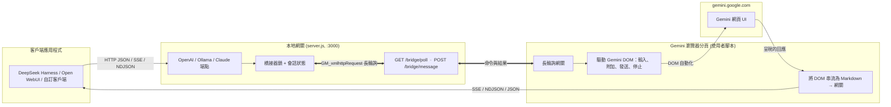
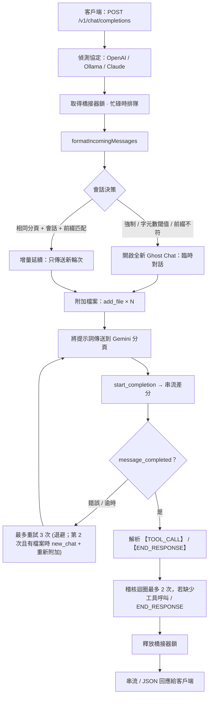
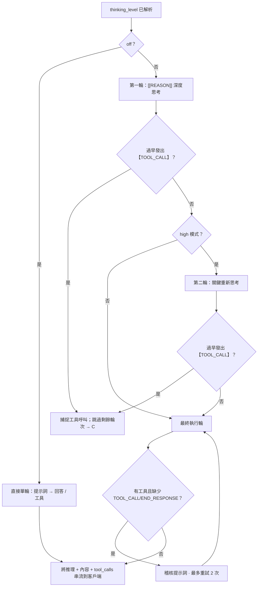
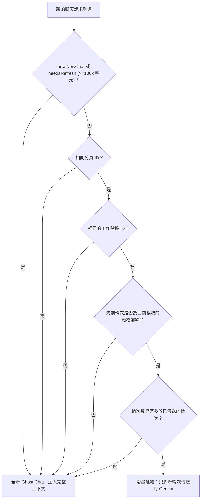
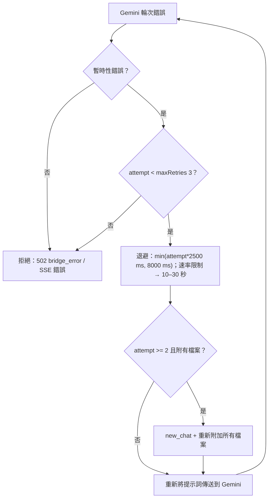
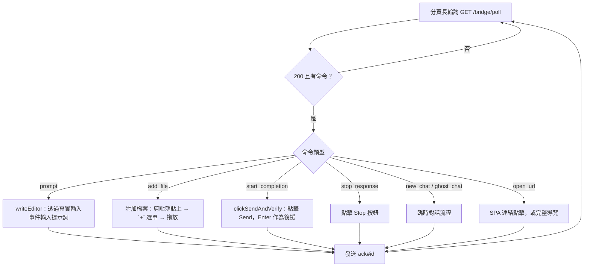

# Gemini Web Bridge

> 把 Gemini 網頁版 (`gemini.google.com`) 當成本地 OpenAI / Ollama / Claude 端點來驅動。一個 Tampermonkey 使用者腳本操作你的瀏覽器分頁；Express 網關則說你客戶端的協定。

[](README.md#授權)
[](https://nodejs.org)
[](https://expressjs.com)

## 一覽表

| | |
|---|---|
| **網關** | `server.js` — Express，監聽 `http://127.0.0.1:3000` |
| **瀏覽器驅動程式** | `public/gemini-bridge.userscript.user.js` — Gemini 網頁版使用者腳本 |
| **分頁 ↔ 網關** | 長輪詢經 `GM_xmlhttpRequest`（Gemini 的 CSP 封鎖 WebSocket 到 `127.0.0.1`） |
| **模型 ID** | `gemini-web` |

## 語言版本

- [English（本檔）](../README.md)
- [中文（繁體）](README.traditional.md)
- [中文（简体）](../README.simplified.md)

---

## 目錄

- [概述](#概述)
- [架構](#架構)
- [快速入門](#快速入門)
- [API 參考](#api-參考)
- [請求範例](#請求範例)
- [思考 / 推理模式](#思考-推理模式)
- [Ghost Mode（臨時對話）與會話](#ghost-mode-臨時對話與會話)
- [工具呼叫 / 本地函數協議](#工具呼叫-本地函數協議)
- [檔案與圖片附件](#檔案與圖片附件)
- [環境變數](#環境變數)
- [使用者限制與注意事項](#使用者限制與注意事項)
- [邏輯參考](#邏輯參考)
- [流程圖](#流程圖)
- [疑難排解](#疑難排解)
- [安全說明](#安全說明)
- [授權](#授權)

---

## 概述

`gemini-bridge` 將 Gemini 網頁版變成你可以像呼叫其他本地 LLM 端點一樣呼叫的模型端點。你的客戶端傳送一般的聊天請求到 `http://127.0.0.1:3000/v1/chat/completions`（或 Ollama / Claude 風格的路徑），橋接器會：

1. 選擇（或復用）由使用者腳本驅動的作用中 Gemini 瀏覽器分頁。
2. 視需要開啟全新的 **Ghost Mode（臨時對話）** 視窗，乾淨地注入上下文。
3. 將你的提示詞輸入 Gemini 的編輯器，附加任何檔案或圖片，點擊 **Send**。
4. 當 Gemini 在 DOM 中回應時，將串流回應轉成 Markdown 傳回你的客戶端。
5. 支援多輪「思考」（`off` / `low` / `medium` / `high`）、透過 `【TOOL_CALL name="..."】` 進行工具呼叫、在 Gemini 網頁暫時性錯誤時自動重試，以及跨輪次的會話延續。

> **同一時間只有一個橋接器分頁。** 網關保留單一作用中分頁。若第二個 Gemini 分頁聲稱橋接器，第一個會停止。同一時間只應讓一個分頁運行橋接器。

---

## 架構



使用者腳本會將一個懸浮按鈕注入 Gemini 頁面。點擊它將分頁註冊為橋接器；分頁隨後對 `GET /bridge/poll` 進行長輪詢，等待命令（`prompt`、`add_file`、`start_completion`、`stop_response`、`new_chat`、`open_url`），並透過 `POST /bridge/message` 回報結果。

---

## 快速入門

### 1. 安裝依賴套件

```bash
cd gemini-bridge
npm install
```

唯一依賴：`express`（以及 Node.js 內建模組：`events`、`crypto`、`fetch`）。

### 2. 安裝使用者腳本

在你用來開啟 Gemini 的瀏覽器中安裝 Tampermonkey 或 Violentmonkey，然後加入此使用者腳本：

`public/gemini-bridge.userscript.user.js`

關鍵元資料：

```js
// @name         Gemini Web Bridge for Local Gateway
// @match        https://gemini.google.com/*
// @match        https://gemini.google.com/u/*/app*
// @grant        GM_xmlhttpRequest
// @connect      127.0.0.1
// @connect      localhost
```

### 3. 啟動網關

```bash
node server.js
```

預期輸出：

```
[HTTP] OpenAI-compatible API listening on http://127.0.0.1:3000/v1
[TAB]  Waiting for the userscript to poll http://127.0.0.1:3000/bridge/...
```

### 4. 啟用橋接器分頁

1. 在已安裝使用者腳本的瀏覽器中開啟 `https://gemini.google.com`。
2. 確認處於 **臨時對話（Temporary Chat / Ghost Mode）**。
3. 點擊右下角的懸浮橋接器按鈕，直到顯示 **Bridge active（綠點）**。
4. 分頁現已註冊；`GET /health` 回報 `connected: true`。

### 5. 需煙測試

```bash
curl http://127.0.0.1:3000/health
# {"connected":true,"busy":false}

curl -X POST http://127.0.0.1:3000/v1/chat/completions \
  -H "Content-Type: application/json" \
  -d '{"model":"gemini-web","messages":[{"role":"user","content":"用一句話說你好。"}],"stream":false}'
```

你應該會收到一個 JSON 聊天完成結果，內容是透過你的瀏覽器分頁串流而來的 Gemini 回答。

---

## API 參考

### 基礎網址

```
http://127.0.0.1:3000
```

網關監聽連接埠 `3000`（`HTTP_PORT`）。預設僅監聽本地回環位址；CORS 開放（`Access-Control-Allow-Origin: *`），讓瀏覽器型介面能呼叫。

### 端點

| 方法 | 路徑 | 用途 |
|---|---|---|
| `GET` | `/health` | 健康檢查：`{ connected, busy }` |
| `GET` | `/models` | OpenAI 風格模型清單：`[{ id: "gemini-web", ... }]` |
| `GET` | `/api/tags` | Ollama 模型清單 |
| `GET` | `/api/version` | Ollama 版本：`{ "version": "0.5.0" }` |
| `GET` | `/bridge/poll` | 使用者腳本長輪詢（分頁在此註冊；持續等待直到有命令可用或回傳 204） |
| `POST` | `/bridge/message` | 使用者腳本發送 `report_existence`、`ack`、`error`、`message_stream`、`message_completed` |
| `POST` | `/*(chat/completions\|api/chat\|api/generate\|messages\|openai\|open-ai\|ollama\|claude)` | 通用聊天完成處理器（OpenAI / Ollama / Claude） |

### 通訊協定偵測

路徑與標頭決定回應的傳輸格式：

| 條件 | 協定 |
|---|---|
| 路徑以 `/messages` 結尾、包含 `/claude` 或 `/anthropic/`、或有 `anthropic-version` 標頭 | **Claude**（SSE，Anthropic 事件） |
| 路徑以 `/api/chat`、`/api/generate` 結尾，或包含 `/ollama` | **Ollama**（NDJSON） |
| 否則 | **OpenAI**（SSE `data:` 區塊 + `data: [DONE]`） |

因此你可以呼叫 `POST /v1/chat/completions`（OpenAI）、`POST /api/chat` 或 `/api/generate`（Ollama）、或 `/messages`、`/claude/...`（Claude）。

### 聊天請求主體

```json
{
  "model": "gemini-web",
  "messages": [ { "role": "user", "content": "..." } ],
  "stream": true,
  "thinking_level": "medium",
  "reasoning_effort": "medium",
  "new_chat": false,
  "tools": [ ... ],
  "enable_thinking": false
}
```

| 欄位 | 類型 | 預設 | 意義 |
|---|---|---|---|
| `model` | 字串 | `"gemini-web"` | 模型標籤，會回應中回報。 |
| `messages` | 陣列 | 必填 | OpenAI 風格訊息。`prompt` 字串可作為單一使用者訊息的後援。 |
| `prompt` | 字串 | — | `messages` 的替代方案：視為一個使用者輪次。 |
| `stream` | 布林 | `true` | 為 `false` 時，完成後傳回單一 JSON 回應。 |
| `thinking_level` / `reasoning_effort` | 字串 | `"off"` | `off`、`low`、`medium`、`high`。控制橋接器在最終回答前執行的推理輪次數。 |
| `new_chat` | 布林 | `false` | 強制開啟全新的 Ghost Chat（臨時對話），而非延續目前會話。 |
| `tools` | 陣列 | — | 宣告可用的本地函數；模型可能會發出 `【TOOL_CALL name="..."】` 區塊。 |
| `enable_thinking` | 布林 | — | `false` 會將思考設為 `off`。 |

`body.reasoning`、`body.extra_body.reasoning_effort`、`body.extra_body.thinking_level` 等欄位在解析思考層級時也會被讀取。

> **輸出格式限制。** Gemini 網頁會損壞三個反引號程式碼區塊，因此橋接器指示模型使用 `···` 圍欄，並會從客戶端可見文字中剝離 `[[REASON]]`、`【TOOL_CALL】`、`【END_RESPONSE】` 控制標籤。不要透過此橋接器依賴 ``` 區塊。

### 回應格式

**OpenAI（串流）** — `text/event-stream`:

```
data: { "id": "chatcmpl-...", "object": "chat.completion.chunk", ..., "choices": [{ "delta": { "role": "assistant", "content": "" } }] }

data: { ... "delta": { "content": "Hello" } }

data: [DONE]
```

推理內容會串流在 `delta.reasoning_content` 中；工具呼叫在 `delta.tool_calls` 中。最終使用量區塊會回報 `prompt_tokens`、`completion_tokens`（推理 + 輸出）與 `total_tokens`。

**Ollama（串流）** — `application/x-ndjson`:

```json
{ "model": "gemini-web", "created_at": "...", "message": { "role": "assistant", "content": "Hello" }, "done": false }
{ "model": "...", ..., "done": true, "done_reason": "stop", ... }
```

對 `/api/generate`，區塊會使用頂層的 `response` 欄位而非 `message`。

**Claude（串流）** — `text/event-stream`，事件包含：`message_start`、`content_block_start`、`content_block_delta`、`content_block_stop`、`message_delta`、`message_stop`。

**非串流** — 單一 JSON 物件，形狀與偵測到的協定相符（OpenAI / Ollama / Claude）。

### 錯誤

| 狀態 | 意義 |
|---|---|
| `400` | 缺少 `messages` / `prompt`。 |
| `502`（非串流）或 SSE 錯誤事件（串流） | `bridge_error` 當分頁未連線、超時，或 Gemini 回傳不可重試錯誤時。 |

Gemini 的暫時性錯誤（速率限制、`1095`、網路中斷、空白輸出）會自動重試（見 [重試邏輯](#重試邏輯)）。

---

## 請求範例

### cURL（OpenAI，非串流）

```bash
curl -X POST http://127.0.0.1:3000/v1/chat/completions \
  -H "Content-Type: application/json" \
  -d '{
    "model": "gemini-web",
    "messages": [{"role":"user","content":"用一段話解釋量子運算。"}],
    "stream": false,
    "thinking_level": "medium"
  }'
```

### cURL（Ollama）

```bash
curl -X POST http://127.0.0.1:3000/api/chat \
  -H "Content-Type: application/json" \
  -d '{
    "model": "gemini-web",
    "messages": [{"role":"user","content":"你好"}],
    "stream": false
  }'
```

### Python（使用 OpenAI SDK，指向本地橋接器）

```python
from openai import OpenAI

client = OpenAI(
    base_url="http://127.0.0.1:3000/v1",
    api_key="not-needed",
)

resp = client.chat.completions.create(
    model="gemini-web",
    messages=[{"role": "user", "content": "Hi, are you there?"}],
    stream=False,
)
print(resp.choices[0].message.content)
```

### JavaScript（fetch，串流）

```javascript
const res = await fetch("http://127.0.0.1:3000/v1/chat/completions", {
  method: "POST",
  headers: { "Content-Type": "application/json" },
  body: JSON.stringify({
    model: "gemini-web",
    messages: [{ role: "user", content: "幫我寫一首詩並串流輸出。" }],
    stream: true,
  }),
});

const reader = res.body.getReader();
while (true) {
  const { done, value } = await reader.read();
  if (done) break;
  // 此處解析 "data: ..." SSE 區塊
}
```

---

## 思考 / 推理模式

`thinking_level`（又稱 `reasoning_effort`）控制橋接器在執行工具或回傳文字前，如何準備答案：

| 模式 | 行為 | 推理輪次 |
|---|---|---|
| `off` | 直接單輪：提示詞 → 回答（或工具呼叫） | 0 |
| `low` | 一輪深度思考 (`[[REASON]]...[[/REASON]]`)，然後最終執行輪 | 1 |
| `medium` | 與 `low` 相同 | 1 |
| `high` | 深度思考輪，然後進行 **關鍵重新思考** 輪，最後才執行 | 2 |

思考層級的解析順序：

1. `enable_thinking === false`、`thinking.type === "disabled"`、`reasoning.enabled === false`、或 `reasoning.exclude === true` → `off`
2. `thinking_level` ?? `reasoning_effort` ?? `reasoning.effort` ?? `extra_body.reasoning_effort` ?? `extra_body.thinking_level`
3. 缺失 / 空字串 → `off`
4. `off|none|disabled|false|0` → `off`；`low|minimal` → `low`；`high|xhigh|max` → `high`；其他 → `medium`

### 輪次流程

1. **第一輪 — 深度思考：** 要求 Gemini 在 `[[REASON]]...[[/REASON]]` 內部推理（純文字，不含 Markdown、不含工具呼叫）。
2. **第二輪 — 關鍵重新思考**（僅 `high` 模式）：第二輪檢查是有更好的解決方案、遺漏細節，或潛在錯誤。
3. **最終 — 執行輪：** 模型輸出 `【TOOL_CALL name="..."】{...}【/TOOL_CALL】` 區塊來呼叫本地函數，或輸出純文字答案並以 `【END_RESPONSE】` 結束。
4. **稽核迴圈（最多 2 次嘗試）：** 若預期會有工具，但既沒有 `【TOOL_CALL】` 也沒有 `【END_RESPONSE】`，橋接器會發送稽核提示詞並重試。

推理文字會在產生時，以 `reasoning_content`（OpenAI）或 `thinking`（Ollama）形式串流到客戶端。

---

## Ghost Mode（臨時對話）與會話

橋接器讓 Gemini 在 **臨時對話（Temporary Chat，Ghost Mode）** 中運行，讓每個對話從乾淨視窗開始，且不會被用來訓練模型。

### 會話規則

- 會話嚴格綁定到當前瀏覽器分頁的 `tabId`。若分頁斷線，會話即結束（`ghostSession = null`）。
- 在以下情況會開啟全新的 Ghost Chat：
  - 請求 `new_chat: true`，或
  - 會話字元數達到閾值（`cumulativeChars >= 100000`，約為 32k 內容窗口的安全餘量），或
  - 尚無有效會話。
- **延續（增量模式）：** 若同一個分頁、相同的工作階段 ID，且先前的非助手訊息嚴格為目前訊息的前綴，則只會將「新增的」輪次傳送給 Gemini，避免重複傳輸完整歷史。
- 嚴格的存活檢查：相同分頁 ID + 相同的 `clientSessionId`（`x-session-id` / `x-conversation-id` 標頭，或 `metadata.session_id`）+ `prevNonAssistant` 嚴格為 `normalizedNonAssistant` 的前綴 + 輪次數多於已傳送的輪次。
- 輪次指紋會正規化掉動態時間戳與中繼層注入的執行階段標籤（`<time-context>`、`<runtime-context>`、`<system-reminder>`、`<skill-catalog>` 等），讓中間循環步驟停留在同一會話中。

### 逾時與節流

| 常數 | 預設值 | 意義 |
|---|---|---|
| `TAB_TIMEOUT_MS` | 45 秒 | 分頁 45 秒未輪詢即視為斷線。 |
| `TURN_COOLDOWN_MS` | 2.5 秒 | 連續網頁輪次間的防速率限制間隔。 |
| `BRIDGE_SEND_DELAY_MS` | 5 秒（可透過環境變數覆蓋） | 將提示詞傳送到 Gemini 網頁前的延遲。 |
| `STREAM_STALL_TIMEOUT_MS` | 180 秒 | 串流停滯 3 分鐘則中止輪次。 |
| `TAB_OFFLINE_TIMEOUT_MS` | 15 秒 | 看門狗：分頁離線 15 秒則輪次失敗。 |
| `MAX_SESSION_CHARS` | 100 000 | 會話字元數閾值，超過後下一輪會開啟新的 Ghost Chat。 |

---

## 工具呼叫 / 本地函數協議

當宣告 `tools` 時，Gemini 可能會輸出本地工具呼叫，而非（或在）純文字回答。橋接器永不使用 Gemini 內建的 Python 沙箱或網頁工具；所有執行都透過你的本地工具層完成。

### 傳輸格式

```
【TOOL_CALL name="function_name"】{"arg1": "value1"}【/TOOL_CALL】
```

多行內容（檔案路徑、程式碼）：

```
【TOOL_CALL name="write"】{"file_path": "example.html", "content": "⟦CONTENT_START⟧
<!DOCTYPE html>...
⟦CONTENT_END⟧"}【/TOOL_CALL】
```

規則：

- 使用精確的裸函數名稱 — 永不加 `default_api:` 前綴。
- 程式碼區塊使用 `···`（三個中間點）作為圍欄，**永不**使用三個反引號 ``` — Gemini 網頁會損壞反引號區塊。
- 純文字答案以 `【END_RESPONSE】` 結尾；若仍需呼叫工具，請不要輸出它。
- 橋接器會解析 `【TOOL_CALL】`/`【/TOOL_CALL】` 區塊（也可容忍 `[` `]` 括號變體，以及長區塊後遺漏的閉合標籤），將其發送為回應中結構化的 `tool_calls`，並執行稽核迴圈（最多 2 次嘗試），以防模型遺漏它們。

### OpenAI 工具呼叫回應

串流 OpenAI 回應會發送 `delta.tool_calls` 區塊；非串流回應會在 `message.tool_calls` 中包含，並以 `finish_reason: "tool_calls"` 結束。

---

## 檔案與圖片附件

附件從請求主體經過網關，傳送到使用者腳本，由腳本貼到 Gemini 的編輯器中（剪貼簿貼上 → `+` 選單 → 拖放後援），並等待上傳完成。

支援的部分類型：

- `text` — 一般文字
- `image_url`（OpenAI 風格）— `data:image/...;base64,...` 或 `https://` 網址（由伺服器端擷取）
- `image` / `source.base64`（Claude 風格）
- `file` — `{ filename, file_data }` 文字附件
- `images` — Base64 字串陣列

圖片預估約 258 個 trion；文字檔案使用 CJK 感知估算器計算。若設定 `GEMINI_API_KEY`，則會透過 Google 的 `countTokens` REST API 取得精確 trion 數；否則使用本地估算器（失敗時回退）。

---

## 環境變數

| 變數 | 預設值 | 意義 |
|---|---|---|
| `GEMINI_API_KEY` | `""` | 啟用透過 Google `countTokens` REST API（`gemini-2.5-flash`）的精確 trion 計算。 |
| `BRIDGE_SEND_DELAY_MS` | `5000` | 在將提示詞傳送到 Gemini 網頁前等待的毫秒數（有助於避免速率限制）。 |

```bash
GEMINI_API_KEY=your_key BRIDGE_SEND_DELAY_MS=3000 node server.js
```

---

## 使用者限制與注意事項

在整合橋接器前，請先檢視這些限制。

1. **需要 Gemini 帳戶與網頁版。** 需要一個可運作的 Gemini 帳戶並能存取 `gemini.google.com`。橋接器驅動的是官方網頁版；產生內容不需要 Gemini API 金鑰（僅用於選擇性的 trion 計算）。
2. **同一時間只能有一個橋接器分頁。** 同一時間只應讓一個分頁運行橋接器；另一個分頁聲稱橋接器會停止先前的分頁。
3. **僅限臨時對話（Ghost Mode）。** 每個會話都在臨時對話中開啟。若你需要在 Google 端保留持續的 Gemini 對話歷史，本橋接器不會保留 — 會話是短暫性的。
4. **無 WebSocket，僅長輪詢。** 因為 Gemini 的 CSP 封鎖 `ws://127.0.0.1`，所以分頁 ↔ 網關傳輸使用 HTTP 長輪詢（`GET /bridge/poll`），通常每 100 毫秒至 1 秒輪詢一次，錯誤時會指數退避。
5. **Gemini 速率限制適用。** 所有產生都會消耗你的 Gemini 網頁配額。速率限制錯誤（例如 `(1095)`、`Rate limit`）會觸發自動重試並退避，但頻繁大量使用仍可能被 Google 節流。
6. **需要使用者腳本管理員。** 必須安裝 Tampermonkey/Violentmonkey（或類似），並為 `127.0.0.1` 與 `localhost` 授權 `GM_xmlhttpRequest`。使用者腳本僅在 `gemini.google.com` 的頂層框架運行（助手框架會被忽略）。
7. **並行限制：一次只處理一個請求。** 橋接器鎖定會序列化聊天請求。執行中的請求期間，其他請求會排隊並依序處理；`GET /health` 在執行期間會回報 `busy: true`。
8. **逾時。** 分頁離線：15 秒 → 輪次失敗。串流停滯：180 秒 → 輪次失敗。`start_completion` 等待：35 秒；`performAction` 預設：20 秒；`add_file`：60 秒。
9. **會話大小閾值。** 當累積會話字元數達到 100 000 時，下一輪會開啟新的 Ghost Chat（會傳遞上下文摘要）。非常長的對話會重新啟動上下文。
10. **本地執行風險。** 橋接器會將本地檔案/工具存取的工具協議暴露給連線的模型（依你的工具層而定）。僅連線可信任的客戶端；CORS 預設為開放 `*`。
11. **並非 Google 官方產品。** 這是一個非官方的橋接器，會自動化 Gemini 網頁版。若 Google 變更頁面 DOM 或類別名稱，行為可能會改變（使用者腳本盡可能使用角色、標籤與文字而非雜湊類別，但某些選擇器仍依賴 DOM）。

---

## 邏輯參考

### 聊天完成請求生命週期

```
Client POST /v1/chat/completions
  ├─ 偵測協定（OpenAI / Ollama / Claude）
  ├─ 取得橋接器鎖（忙碌時排隊）
  ├─ formatIncomingMessages():
  │    ├─ 建立 workspace_spec.txt（系統提示詞 + 工具 + 輸出規則）
  │    ├─ 標題產生捷徑 → 本地回答，不碰 Gemini 分頁
  │    └─ 會話決策：延續 vs 新的 Ghost Chat
  ├─ 若新的 Ghost Chat：使用者腳本 new_chat（臨時對話）
  ├─ 附加檔案（add_file，逐一處理，每個 60 秒）
  ├─ 將提示詞傳送到 Gemini 分頁（prompt 動作）
  ├─ start_completion → 串流差分 → message_completed / 錯誤
  ├─ （思考模式）在最終輪次前執行推理輪次
  ├─ （工具模式）解析 【TOOL_CALL】 區塊；稽核迴圈最多 2 次
  ├─ 釋放橋接器鎖
  └─ 傳回串流/JSON 回應給客戶端
```

### 會話延續邏輯

```
新請求到來
  │
  ├─ forceNewChat 或 needsRefresh？ ─────────────── 是 → 新的 Ghost Chat（完整上下文）
  │
  否
  │
  ├─ 相同分頁 ID？ ───────────────────────────── 否 → 新的 Ghost Chat
  │
  ├─ 相同的工作階段 ID？ ─────────────────────── 否 → 新的 Ghost Chat
  │
  ├─ 先前輪次是否為目前輪次的嚴格前綴？ 否 → 新的 Ghost Chat
  │
  ├─ 輪次數是否多於已傳送的輪次？ ───────────── 否 → 新的 Ghost Chat
  │
  └─ 是 → 增量延續：只將新輪次傳送給 Gemini（高效率）
```

### 思考輪次邏輯

```
thinking_level == "off"？
  是 → 直接單輪 → 【TOOL_CALL】 或 【END_RESPONSE】 → 完成
  否 → 第一輪：[[REASON]] 深度思考
       ├─ 模型是否過早發出 【TOOL_CALL】？ → 捕捉它，跳過剩餘輪次
       ├─ high 模式？ → 第二輪：關鍵重新思考
       │     ├─ 過早發出 【TOOL_CALL】？ → 捕捉它，跳過最終輪
       │     └─ 進行最終執行輪
       └─ 最終執行輪 → 工具呼叫，或純文字答案 + 【END_RESPONSE】
             ├─ 稽核迴圈（最多 2 次），若缺少工具呼叫 / END_RESPONSE
             └─ 將文字 + tool_calls 串流到客戶端
```

### 重試邏輯

```
Gemini 輪次錯誤
  │
  ├─ 是暫時性錯誤？ (速率限制、1095、「Something went wrong」、網路、空白輸出、停滯、逾時)
  │   是 → attempt < maxRetries (3)？
  │       是 → 退避：min(attempt*2500 ms, 8000 ms)；速率限制 → 10–30 秒
  │           ├─ attempt >= 2 且附有檔案 → new_chat + 重新附加所有檔案
  │           └─ 重新傳送提示詞
  │       否 → 拒絕 → 502 bridge_error / SSE 錯誤
  │
  否 → 立即拒絕 → 502 bridge_error / SSE 錯誤
```

### 使用者腳本命令處理迴圈

```
分頁長輪詢 GET /bridge/poll → {200 且有命令？}
  否 → 回到輪詢
  是 → {命令類型}
       prompt       → writeEditor：透過真實輸入事件將提示詞寫入編輯器
       add_file     → 附加檔案：剪貼簿貼上 → `+` 選單 → 拖放後援
       start_completion → clickSendAndVerify：點擊 Send，Enter 作為後援
       stop_response → 點擊 Stop 按鈕
       new_chat / ghost_chat → 臨時對話流程
       open_url     → SPA 連結點擊，或完整導覽
       → 發送 ack#id → 回到輪詢
```

### Trion 估算（本地後援）

```
CJK 字元 * 1.15
+ 拉丁文字：每個單字 max(1, ceil(長度 / 4))
+ 程式碼標點 * 0.65
+ 圖片 * 258
```

當設定 `GEMINI_API_KEY` 時，會透過 `https://generativelanguage.googleapis.com/v1beta/models/gemini-2.5-flash:countTokens?key=...` 取得精確計算；任何失敗時會回退到本地估算器。

---

## 流程圖

下方圖表使用 Mermaid 語法，可在 GitHub、GitLab 與大多數 Markdown 檢視器中呈現。

### 1. 系統架構


### 2. 聊天完成生命週期



### 3. 思考 / 推理輪次



### 4. 會話延續 vs 全新 Ghost Chat



### 5. 重試邏輯



### 6. 使用者腳本命令迴圈



---

## 疑難排解

| 症狀 | 可能原因 | 修復方式 |
|---|---|---|
| `GET /health` → `connected: false` | 使用者腳本未運行，或分頁未註冊 | 開啟 Gemini，點擊橋接器按鈕直到顯示「Bridge active」 |
| 輪詢錯誤：`Cannot reach http://127.0.0.1:3000` | 網關未啟動 | 執行 `node server.js` |
| `502 bridge_error: No active Gemini Web Bridge connected` | 分頁已關閉、離開頁面，或逾時 (45 秒) | 重新啟用橋接器分頁；重新開啟 Gemini |
| 輪次在 180 秒後失敗 | 串流停滯 | 檢查 Gemini 分頁；簡化提示詞；重試 |
| 速率限制 `(1095)` /「減速中」 | Gemini 網頁配額 | 等待；降低併發；增加 `BRIDGE_SEND_DELAY_MS` |
| 程式碼區塊損壞 | Gemini 網頁損壞三個反引號 | 模型輸出使用 `···` 圍欄；這是設計使然 |
| `另一個分頁已聲稱橋接器` | 兩個分頁同時運行橋接器 | 除了其中一個分頁，全部停止橋接器 |
| 檔案附加失敗 | 編輯器未就緒，或上傳轉盤卡住 | 等待發送按鈕可用；圖片會額外增加約 800 毫秒穩定時間 |
| 上下文經常重置 | 會話達到 100k 字元閾值 | 預期行為；傳遞 `new_chat: true` 可手動強制清空開始 |

---

## 安全說明

- 網關預設綁定到 `127.0.0.1:3000`。未經驗證請勿將其暴露到網際網路。
- CORS 設為 `Access-Control-Allow-Origin: *`，以允許瀏覽器型客戶端；若在共享環境運行，請在 `server.js` 中收緊這個標頭。
- `【TOOL_CALL】` 協議可讓模型透過你的工具層呼叫本地函數。僅連線可信任的客戶端。
- `GM_xmlhttpRequest` 賦予使用者腳本對 `127.0.0.1`/`localhost` 的特權 HTTP 存取；僅從此儲存庫或你已審核的來源安裝使用者腳本。

---

## 授權

AGPL-3.0